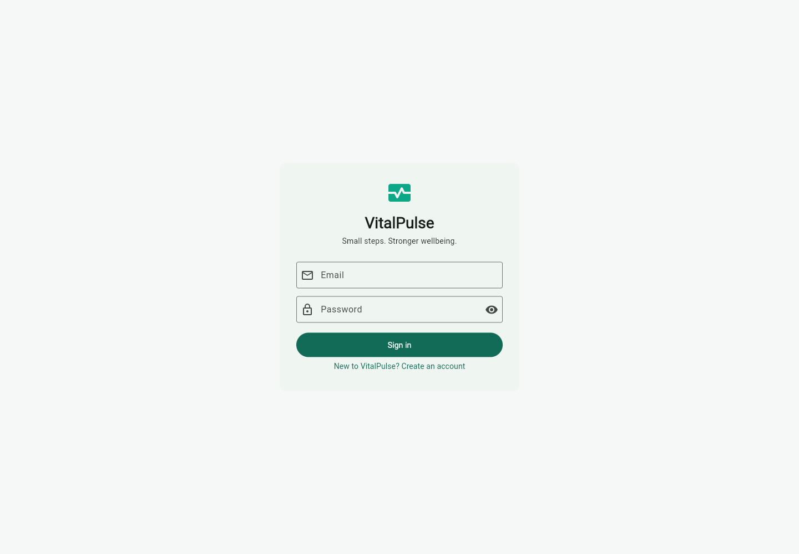
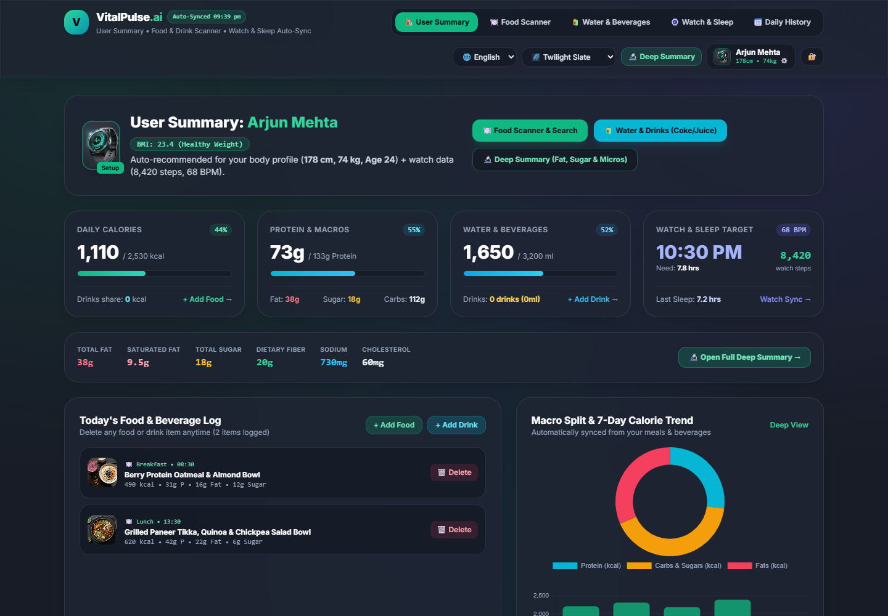
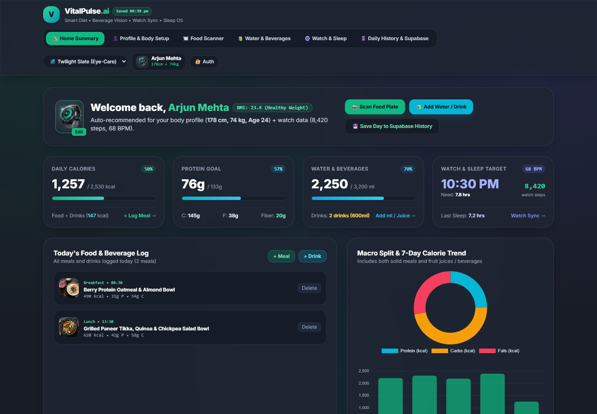
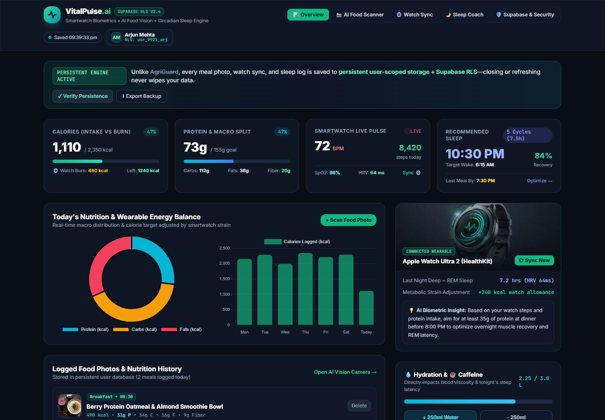

# VitalPulse — AI health & nutrition companion

VitalPulse is one Flutter application for nutrition and daily wellness tracking, backed by Supabase Auth and a row-level-secured Postgres database. The same application is built for web, Android, iOS, and Windows.

The original HTML prototypes are retained in `demos/` for project history. The published site maps their old page names and paths to the same authenticated Flutter app so they no longer present separate, inconsistent products. Prototype HTML opened directly from the source checkout is not a secure login or data service.

## Project layout

- `vitalpulse_app/` — Flutter app for Android, iOS, web, and Windows.
- `supabase/` — backend configuration and database migrations.
- `supabase/functions/analyze-food/` — authenticated, rate-limited AI meal scanner. Provider secrets are stored server-side.
- `demos/` — three original HTML prototypes, retained as source history; deployed addresses route to the shared Flutter app.
- `docs/screenshots/` — screenshots of the app and demos.
- `docs/privacy-policy.md` — starter privacy policy for review before release.

## Screenshots

| Flutter sign-in | Food & drink scanner prototype |
| --- | --- |
|  |  |

| Personalized diet prototype | Supabase dashboard prototype |
| --- | --- |
|  |  |

## Start the app

Read [`vitalpulse_app/README.md`](vitalpulse_app/README.md) to configure a Supabase project, apply migrations, and run the app from VS Code. The Flutter app needs a Supabase project URL and public anon/publishable key at launch. Never put a service-role key in the client.

Open `vitalpulse_app/` as the VS Code workspace. Install the Flutter and Dart extensions, then run the app from VS Code's Run and Debug panel or with `flutter run`.

## Backend security

The migration in `supabase/migrations/` enables and forces RLS on profiles, nutrition records, and daily health records. All rows are owner-scoped to the Supabase Auth user. It applies input range constraints and grants table access only to authenticated users. Apply the migration before using a cloud project.

## Current scope

The app supports email/password account creation and sign-in, per-user profiles and targets, quick food and beverage logging, detailed macro entry, hydration tracking, optional Apple Health / Health Connect read sync for steps, heart rate, and sleep, a sleep-cycle planner, seven-day health history, JSON backup, and photo-based food or beverage nutrition estimates with user review. A photo is sent to the configured AI provider only after the user chooses a scan. Photos are not retained by VitalPulse. Estimates are approximate and should be reviewed before saving.

## Supabase CLI

From the project root:

```powershell
npx supabase login
npx supabase link --project-ref YOUR_PROJECT_REF
npx supabase db push
npx supabase functions deploy analyze-food
```

For meal photo scans, configure `OPENROUTER_API_KEY`, `GEMINI_API_KEY_1`, `GEMINI_API_KEY_2`, and the deployed origin in `ALLOWED_ORIGINS` as Supabase Edge Function secrets. Provider keys remain server-side. The function verifies the user's Supabase session, applies a 20-scan daily account limit, validates image type and size, and returns an approximate estimate. On iOS, enable the HealthKit capability in the signing profile. On Android, install Health Connect and review the privacy policy before requesting permissions.

## Website deployment

The public site is built from the same Flutter source and deployed to GitHub Pages on pushes to `main`. After enabling **Settings → Pages → Source: GitHub Actions**, the live app will be available at [VitalPulse on GitHub Pages](https://yeshwanthkushi25-glitch.github.io/VitalPulse/). The three older demo paths and original HTML filenames are compatibility addresses for that same app. Android preview APKs are published as workflow artifacts.
